<!--
  MES NOTES — mode d'emploi

  Pour ajouter une note, copiez ce modèle EN HAUT de la liste (sous ce cadre) :

  ## 2026-10-10
  #cours #idées
  Le texte de la note. Il peut faire
  plusieurs lignes.

  - 1re ligne : « ## » puis la date au format année-mois-jour.
  - 2e ligne (facultative) : les sujets, chacun commence par #.
  - Ensuite : le texte.
  Ce cadre gris n'apparaît pas sur le site.
-->

## 2026-10-10
#artist #installation #thesis

I discovered an installation by Vytas Jankauskas *Life Forever Spa*.

I really like the tone between performance, immersive experience and all of the references implied to the purgatory, the relation to time.

I also discovered the museum that has comissionned this work.
The Foundation for Art and Creative Technology (FACT) is the UK's leading centre for contemporary art, cinema and digital culture, located in Liverpool.

[Life forever Spa](https://vjnks.com/projects/life-forever)

## 2026-10-09
#thesis #alumni #VJing
Lise Mendes's Thesis "VJing through social media".

I feel the structure is really clear and so it's easy to navigate.

## 2026-10-13
#artist #theory
Notes on Wendy Chun based on this article : [*Data Segregation and Algorithmic Amplification: A Conversation with Wendy Hui Kyong Chun*](https://www.researchgate.net/publication/335875650_Data_Segregation_and_Algorithmic_Amplification_A_Conversation_with_Wendy_Hui_Kyong_Chun) and this video : [*How are machine learning algorithms driving polarisation? by The British Academy*](https://youtu.be/AK_zNivJLMk?si=kdkFQ_X2Y7SjhfMy).

## 2026-10-14
#artist #theory #JoelVacheron

Joel Vacheron, conference, *Unseeing Space Imagery*

Their work published in a book *Cosmovision*

Inspired by [*Whole World Catalogue*](https://wholeearth.info/p/whole-earth-catalog-fall-1968?format=grid&index=0), Stewart Brand, 1968

The imagery of the universe, and planets have influenced human consciousness. We can't unsee these visions of the universe that engendered techno utopian litterature and culture.

Sci-fi imagery is really idealistic fiction but the litterature is based on tangible science. Exemples : Colonies in Space, Space Colonies, The High Frontier.

Colonialism, extractivism, it seems natural to humans to continue to colonize other lands.
Space anthropologist

Anibal Quijano "The repetition of the expansionsist idea comes from a special culture in which this is normalized". Companies want to make us feel that something very specific is universal.

They tried to collect easy to find imagery and not with a historian perspective.
The term of Cosmovision comes from Smirnoff.

We can learn to look to see have changed the world. We have to unsee how these changes are seen as beauty.

Imagery is never neutral

## 2026-10-14

#thesis #advice
What are the parameters I want to choose to conduct my research.

## 2026-10-07
#thesis #alumni #ElectronicReapropriation

Faustine Perillaud, Mapping electronic reapropiation 2023-2024

Table of contents

Introduction
- I Subcultures & empirical learning in community
- II Electronic reuse in the field of art
- III Re-appropriation in the manufacturing environment
- IV Re-evaluating design practices

Conclusion
Annexes

To me the plan is : Context definition, Artistic examples,  Industrial examples, Open questions

- practices surrounding the reappropriation of electronics in the Western World

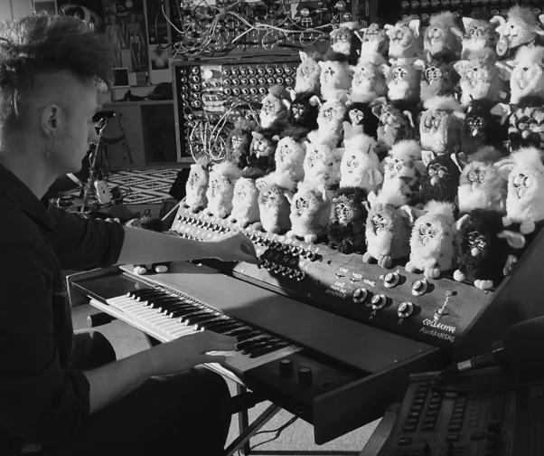

- CCC (Chaos Computer Club), a hacker group active in German-speaking countries since 1981
- The category of "maker" greatly spread the concept of DIY tech culture, but in the process of popularization, it lost the core "punk tech attributes of DIY art."

Materials & method
- fab lab access digital fabrication tools and technologies
- techno-feminist and queerfriendly identity
- feminist hackerspaces were founded as counterproject
- second-hand

" A trans and techno-feminist space for meeting, playing, experimenting and hacking [...]. FluidSpace is a moving, physical space, waiting to be brought to life, where women and gender dissidents can meet from time to time, discuss our relationship with technology, play, open objects, repair them, build new ones, hack systems, invent stories..."

- electronic components ideal low cost
- trying new things without the fear to mess up
- affordable empirical learning matter
- Circuit bending is an experimental approach to electronic music and sound art
- By pressing your finger on the right spots, you can tweak the parameters of the circuit and by the same time, distort the sound of the keyboard
- Their new status after re-use thus oscillates between prototype and intermediate object

Unbinare Lab "Dead bug"
- Producing a tool giving access to this type of component therefore opens the way to a new field of experimentation.
- it enables users to work on a considerably reduced scale, and microelectronics components are often difficult to work with in independent electronics communities

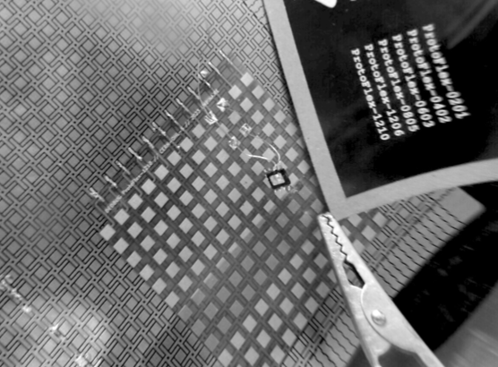

- new experimental perspectives without concurrently requiring new equipment

This thesis is auto-biographic with their relationship to the subject, how they encountered this, some context, and it's also an inventory of what has been done in the field of electronic reapropriation.
I would say mostly chronological.

## 2026-10-14
#artist
Trevor Paglen, The Last Picture

[Creating a mirror to engineer Earth](https://www.reflectorbital.com)

## 2026-10-13
#artist #theory #WendyChun

Discriminating Data: Individuals, Neighborhoods, Proxies

Professor Chun began her talk at the 2019 Congress by outlining the five-step pro-
gram that defines Discriminating Data:

1. Expose and investigate how ignoring differences amplifies discrimination, both currently and historically. (The dangers of hopeful ignorance.)
2. Interrogate the default assumptions and axioms that ground algorithms and data structures. (Eugenics and U.S. segregation as embedded within current network axioms.)
3. Apprehend the future machine-learning algorithms put in place, focusing on when, why, and how their predictions work.
4. Use existing artificial intelligence (AI) systems to diagnose current in-equalities; corralling discriminatory predictions as evidence of current and historical forms of discrimination.

## 2026-10-14
#theory #artist #JamesBridle

[Ways of Being, James Bridle, 2022](https://jamesbridle.com/books/ways-of-being)

[New Dark Age, James Bridle, 2018](https://jamesbridle.com/books/new-dark-age)

## 2026-10-14

#WendyChun #conference
Data Fluencies

Naomi Astra Klen Taylor, End Times Fascism, 2026

Dystopian sci-fi, bunkers, cyberpunk

AGI become the most conspirationnal

They were conviced that AI will destroy the world, they want to accomplish the prophecy
Long termism

Wether or not it will happen, we dont yet know what human intelligence is

Atlas of AI Kate Crawford
The AI Con

Intelligence and language are already artificial but what we really want to avoid is an autoritarian system

Digital democracies institute at Simon Fraser University

They needed to respond to crisis, why and how algorithm discriminates
segregation by algorithm structures

Election of both fake news and Authenticity (Trump)

A way to understand personalized feeds
A global picture of social media trends
Case studies of past events

The researchers don't want to replicate the surveillance

COVID-19 test tool, 

Conflict can be a good sign

Groups are so polarized they're no longer talking to each other

Data literracy - follow the rules
Data fluencies - create speak move things articulate

Even when something is true, does it matter ?

Humanities and AI
Cartographer's tool

Influence functions, the way climate change IA predictions works

Technical Defaults are cultural defaults

Homophily creates networks echo chambers (entre soi, bulle de filtres)
Homophily makes that we repell each other but also attract each other

We need to have gaps to make the networks connections

Data Visceralization

When data shapes our bodies and borders

Kelly Dobson 
Parapraxis of machine design and use

We communicate because we're separation 

Designing communication is designing separation

Blendie, performance, 2003

Companion projects

Questions

## 2026-10-19

#festivals

[Chroniques](https://chroniques.org) (fr)

Kikk (https://kikkfestival.be) (be)

[Ars Electonica](https://ars.electronica.art) (au) 

[Encor Studio](https://www.encor.studio) - Immersive installations, projecting on opaque glass

## 2026-10-19
#artists

[Lauren Thiel](https://thiel.page/magic-house/) - collective drawing space on wheels

[Robin Baugmarten](https://www.wobblylabs.com) 

Memo Akten

### [Danielle Brathwaite-Shirley](https://www.daniellebrathwaiteshirley.com) - artiste multimédia playing with reality and queerness monstrous

## 2026-10-19
#theory

Epistemology is the branch of philosophy that studies the nature, origin, scope, and limits of human knowledge.

## 2026-10-21
#conference #LauraFerrarello #ethics #Methodology

Architecture, EPFL, Design innovation and ethics special interest in AI

Discipline of the future

### Engaging Design: Tools for Design Practices Urging New Forms of Citizenships Laura Ferrarello

AI-informed Design - technology needs data collected from OUR human interactions

Health app - health insurance, body shape, everyday habit, mental health, social status, wellness products

Ethical challenges in AI-informed design, Agency, Dependancy, Cultural Misrepresentation, Limited expression

Because everything relies on data without knowing wether its good or bad info

From ethical challenges to ethical opportunities to challenge assumptions, increase awareness, developp new attitudes and procedures

How to respond to these challenges ?

[Ofri Cnaani](https://ofricnaani.com/Statistical-Bodies)

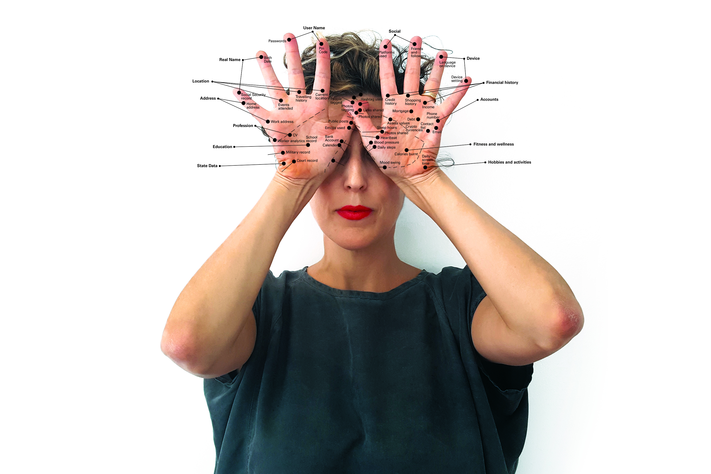

Using question to tackle ethical challenges ?
- being aware of the knowledge we have
- our brain is lazy, we take things for granted
- learning consumes energy
- re-learn make us able to change perspective

The idk is also important, unpack what we think we know

Framing:trade-off V dilemmas

- A dilemma is a standoff between two imperatives perceived as equally compulsory but not achievable

Separate responses - deconstruct the incompatibility of responses in their defining components - can I prioritize ? time sequence ? compartmentalise ?

- A trade-off is understood as a balancing of two imperatives perceived as can be transformed

Reframing my reponses by exploring different attitudes- seek to resolve incompatibilty - can this tension help me rethink ? is there an alternative way ? change of scale help to find a solution ?

How to navigate situations of no apparent solutions ?

- change perceptions of : ideas, practices, narratives, habits, goals, values, emotions and beliefs

Wicked problems are ill-formulated, whose info is confusing, conflicting values

Perspectives are intertwined : economy, health, social, politics (data privacy)

Balancing loops

Ethics needs to share responsability : designer + psychologist, cultural theorist, behavioural scientist, computer scientist, social scientist, anthropologist

Multiple perspectives, multi disciplinary, collective work

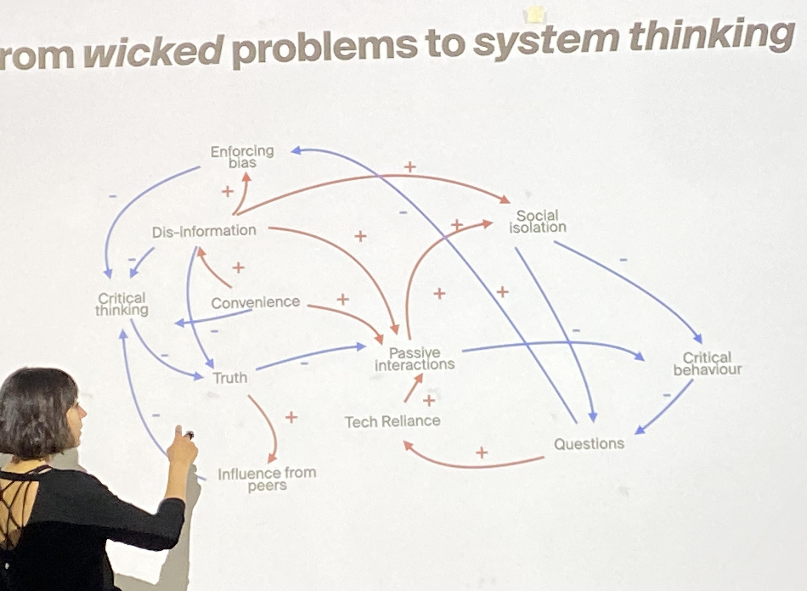
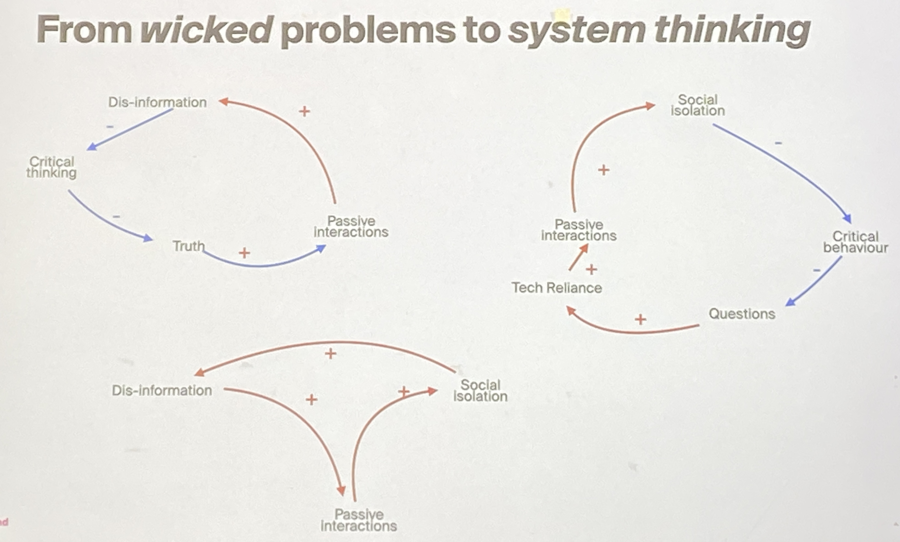

## 2026-10-22
#CreativeCode #RafaëlRozendaal

Amaury showed us the super fun, minimal and poetical websites of [Rafaël Rozendaal](https://www.newrafael.com/internet).

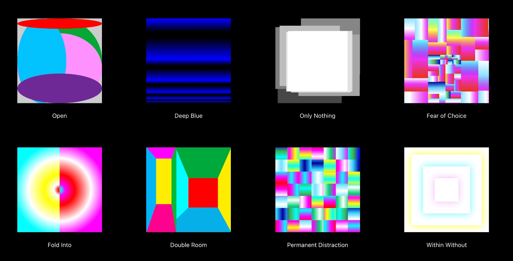

## 2026-10-26
#Workshop #Website #RifkeSadleir

Building websites is kind of like building a house with html.
There is a system of putting boxes in other boxes.
CSS styles HTML.

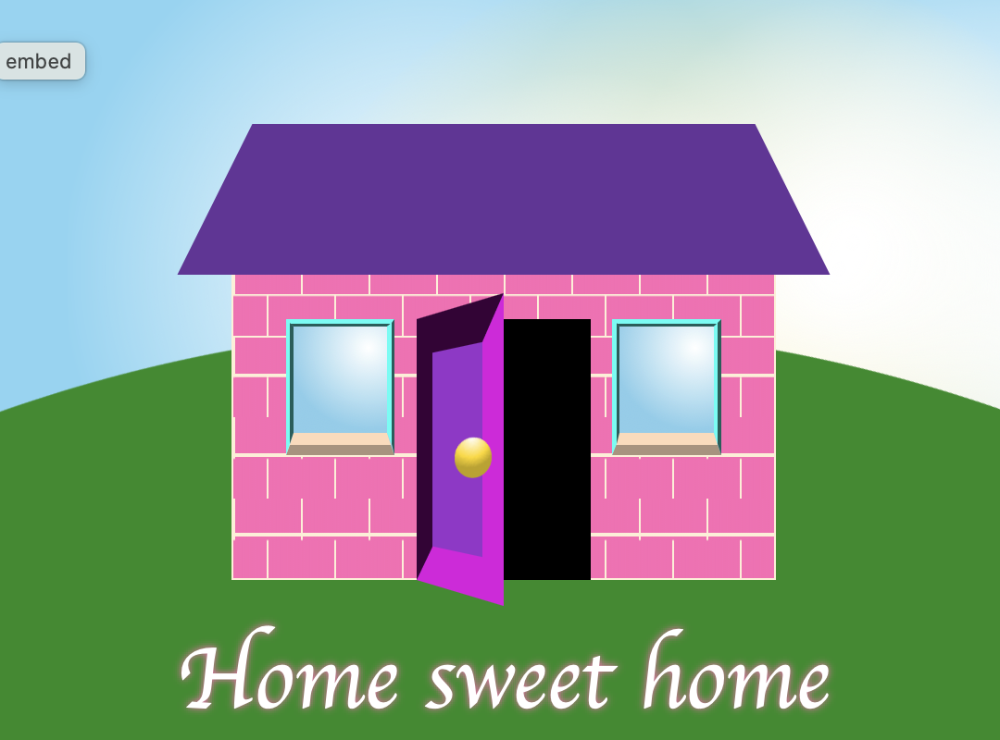

## 2026-10-26
#Website #Idea

Could be a T-shirt idea.

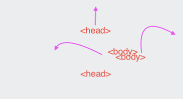

## 2026-10-26
#RifkeSadleir #Website #Workshop

Color on websites written in binary or with hex code.

Each of these sections ranges from 0 to 255, where 0 is no light and 255 is the maximum amount of light coming from that particular colour in the pixel.

Each of these sections ranges from 00 to FF, where 00 is no light and FF is the maximum amount of light coming from that particular colour in the pixel. These values represent the decimal numbers 0-255.

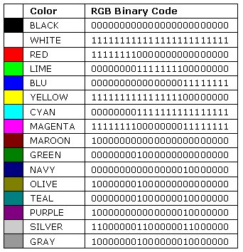

A color book for the nerds ? Amazing

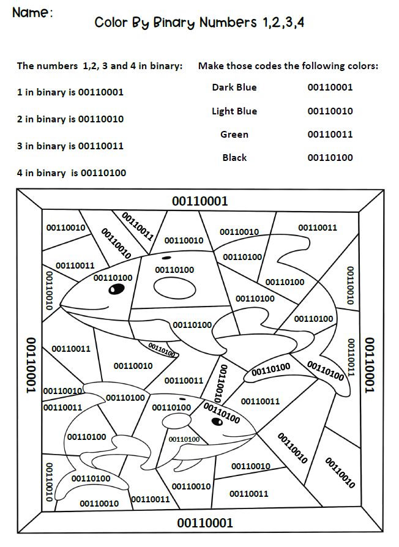

## 2026-10-27
#thesis

Performance ≠ Performing
online performance-ing 
the paradoxe of performance,
boycotting the performative, becoming humans again

## 2026-10-27
#RifkeSadleir #Workshop #thesis

- moderating, the fine line between being authoritarian and libertarian
- hosting a website, creating them is basically affirming a form of authority with your choices

## 2026-10-27
#thesis

I'm obsessed with organograms.

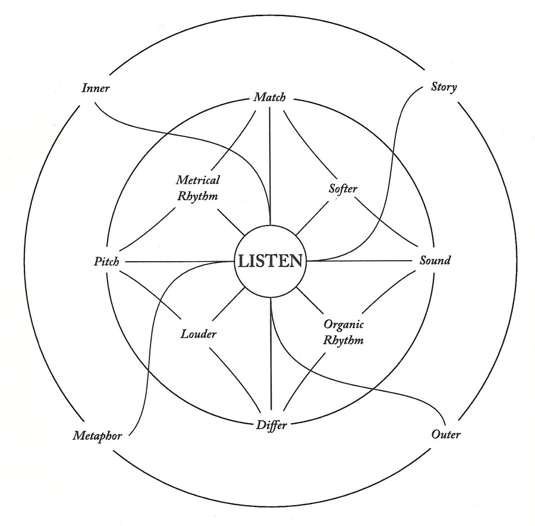

## 2026-11-04
#AndreOurednik #conference

4 november : What is reality ?
18 november : A.I and the ecosystem of meaning

Geographer, philosophy, fiction, agent based modelling, text and data mining
Polyharmonies

Freelance artist
Robopoiesis, les intelligences artificielles de la nature

alterated realities and real alternatives

The Galvanosphere
Electricity

We're spending time and money consuming fiction, videos, films, games.

Concepts of virtual realities

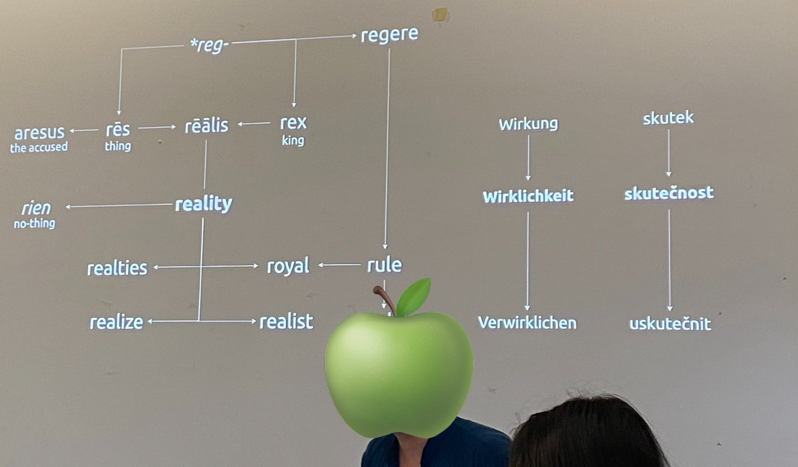

## 2026-11-04
#AndreOurednik #conference

Documentary fiction can change reality

This is a work of finding coherence in reality.

[Forensic Architecture](https://forensic-architecture.org)

Architecture is an art of immersion, Peter Sloterdijk

[Hellblade: Senua's Sacrifice](https://store.steampowered.com/app/414340/Hellblade_Senuas_Sacrifice/), about schizophrenia (beautiful aesthetics), editor Ninja Theory

[Shady Part of Me](https://store.steampowered.com/app/1116580/Shady_Part_of_Me/) super beautiful aesthetics too

Book, Mirijam Did, Everything to Play For: How Videogames Are Changing the World, 2024, editor : le passager clandestin

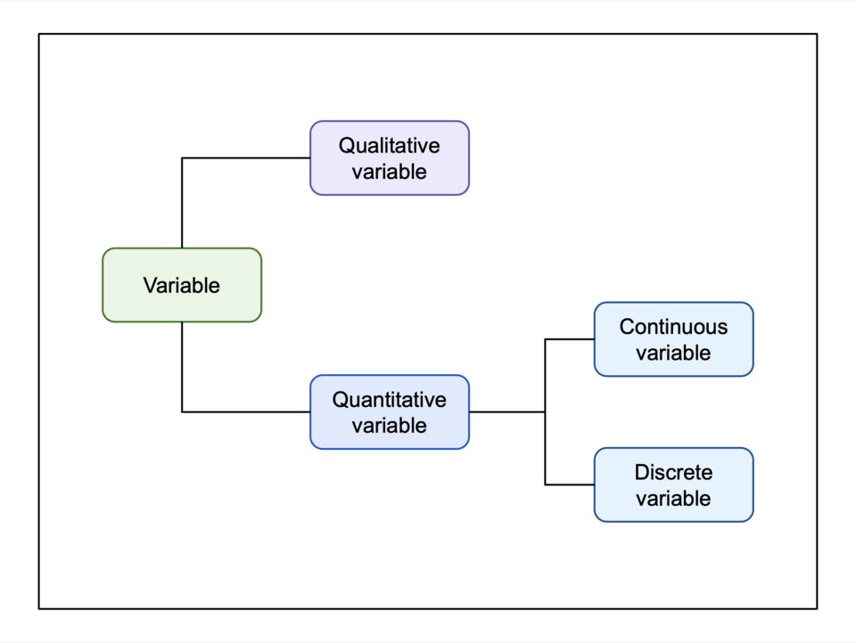

## 2026-11-03
#Idea #FromPlayToPrevention #AdamHudec #MoritzKoenig #Games #Memories #Spaces #DayNightDreams #QuestioningRealities #Live #Lag #Dissociation #AlterEgo #Anonymity #y2k #Obedience #Ritual #Labeling #Boundaries #Body #Mind #IdentityConstruction #Affiliation #Memes #InnerQuest #CulturalInteractiveObject

We’re in a family?
Family intact?
Do we have parents?
We like our big Sibling 
Do they like us?
Do we see that our sibling is suffering or unwell?
We care about our sibling
Do we actively search for clues or do we stumble upon them?
Do we know how to interpret them?
Do we act upon it? Or do we not register the clues and don’t act up on them even tho they’re so obvious that the reader would get them?
We’re 8/9 and the older sibling around 12/13
The spying game is happening at night.
Examples of events happening : 
Finding a photo
Finding an animation
Seeing fucked up things in video games (tortures) Sims

## 2026-11-04
#AndreOurednik #conference #thesis

Elden Ring
Rely on a common cultural ground
Reinvent our own  archetypes

Game, [Manifold Garden](https://store.steampowered.com/app/473950/Manifold_Garden/),

Conversations between self and self as Sigmund [Freud](https://youtu.be/sn-UNGcbi2Q?si=64bdpe5FC4wJ-1ON), 2015, University of Barcelona

#JulietToo, Augmented Reality Installation, Tamiko Thiel, 2022

[Techo-chamanisme](https://adelinschweitzer.com/alphaloop-fr)

## 2026-11-04
#thesis #DesigningQuestions

What to do for next week:
 
- Bring 4 key references central to your interest
- Try to map your subject or question (mind map, write a text, a place, a
community, a series of questions)
- Try to think about your angle of approach

## 2026-11-06
#thesis #DesigningQuestions

Key references from before getting in the master

- Valentin Ranger, The Orgiax Spring
- Arvida Bystrom, Biblically accurate
- Eric Vernhes, Meeting Philipp
- Markos Kay, aBiogenesis
- Marina Abramovic, The artist is present
- Sophie Calle, L'Hotel
- Cyprien Gaillard, HUMPTY / DUMPTY
- Joana Vasconcelos, The Absurd and the Dreamlike
- Max Hooper Schneider, Rotting in a free world

## 2026-11-06
#thesis #DesigningQuestions

Reccurent themes, aesthetics with which I resonate
Rot, entropy, dirty
Speculative, seeking for hope
Party, dance, expression, madness, energy, music, resist

These are not opposite they work together entropy is the reason we need to organize and fight to protect things we value. Building is resisting, rot is also a reminder that everything can transform. Rot is beauty.
I also like that it's something we live with and hide as if we were too important too be mixed with.

A little death, 2002 by Sam Taylor-Johnson

## 2026-11-09
#conference #Mariana #FromPlayToPrevention

The everyday, ordinary social interactions of teenagers are being impacted by digital technology.

Time online: Social connection, Media and culture consumption, Video games

Multisite ethnography
Participant observation, urban walking interviews, digital walking interviews, online ethnography, focus groups in collective reception settings

Shifting away from an adult-centric perspective

The connection is built in person and continues online; today, every stable relationship has an online extension.

Mariana studied sociability around the school and then around the neighborhood.

In online relational spaces, we don't want to share the same things with the same people.

## 2026-11-09
#thesis #Body #AlterEgo

Why do I respectively like about them ?

- Valentin Ranger, The Orgiax Spring
Create a world, no story, talk about bodies, materials, fluidity, fiction and alternatives.

- Arvida Bystrom, Biblically accurate
Body representations, hypersexuality.

- Eric Vernhes, Meeting Philipp
The feeling of symbiosis, synchronicity, sound attacking my core, the words.

- Markos Kay, aBiogenesis
Observing worlds and symbiosis, speculative biology, micro worlds, simulations, simulators. Conway's game of life.

- Marina Abramovic, The artist is present
Sometimes the most impactful thing you could do is to be, in real space, in real time, creating in a way the absolute opposite of cinema ? without having the goal of being objective.

- Sophie Calle, L'Hotel
It's documentary, graphicly interesting, art approach, romanticized by her words.

- Cyprien Gaillard, HUMPTY / DUMPTY
- Joana Vasconcelos, The Absurd and the Dreamlike
- Max Hooper Schneider, Rotting in a free world

## 2026-11-10
#DanielleBrathwaiteShirley #thesis

Online game, installation [Danielle Brathwaite-Shirley](https://kikkfestival.be/talks/danielle-brathwaite-shirley-talk-kikk2026)

Danielle utilizes interactive technologies to create participatory spaces that challenge traditional narratives and encourage active engagement, ultimately creating experiences in which the audience itself becomes the main medium.

Through their innovative use of digital media, Danielle not only preserves histories but also envisions inclusive futures where the voices of those that are ignored or erased are central. Their work is both ‘archive and insurgency’, a catalyst for dialogue, inviting audiences to reflect on their roles within broader societal structures.

## 2026-11-10
#thesis

Questions

What do I want to get better at ?
What do I want to try that I never did ?
symbiosis, synesthesia - audio video, physical space
What is something that matters ?
What did I like so far ? 
What is the tone I would like to use ?

## 2026-11-11
#thesis #LiseMendes #AlterEgo #Body #VJing #Reappropriation

What makes a lot of sense to me compared to other practices: the projects aim to be accessible, to popularize their subject, and to document it, using material that has been gathered or sometimes even created.

Notes on VJing through social media. I'd also like to do research like hers on subjects that are not very well documented, a bit like my thesis on the hyperpop aesthetic.
The themes I had chosen :
Internet aesthetics, retro and minimal games, glitch / A free virtual space, the immaterial body, the figure of the cyber-girl /  Partying as a political act, queer heritage, building community, digital capitalism, reappropriation / Superficiality? Artifice, sincerity, pretty dollcorpse

What was lacking to my opinion ?  
Angle - I want something more personnal, more from me maybe less documentary
Clarity on my POV,  when we talk about DIY vernacular and web, the question of AI has to be mentionned because they didn't get the point I was trying to make on maximalist aesthetics and sounds made with minimal means, something that speaks with sincerity and not caring about some conventions on how we should create.
I didn't explicitely explained the correlation between things and I made some assumptions because it seemed logical to me.
The paradoxe of creating a niche and cutting access to others by being less accessible, being exclusive to the one that excluded us before, repeating the violence?
Even niches and subcultures have codes.

Something interesting - hyperpop as an updated form of pyschedelism whose imagination is no longer based on the use of chemical drugs, but on the effervescence of internet content.
Because it echoes with classes we had on cybernetics and the correlation of the birth of internet and chemical drugs.

Liminal spaces, degradation

## 2026-11-11
#thesis

State of the art

Build the POV and from different fields
Scientific conferences, products, books, articles, debates, that frame your topic.
Key definitions, concepts.
Even if we feel like everything has been already said we can bring our own POV.
Book, Umberto ECO, How to write a thesis 

Choosing the topic
We need to narrow it down, create boundaries on the subject we are going to cover.
Defining 
Angle : Critical, Representation, Scientific, Historical, Experiential, Speculative

Tips
Look into bibliographies, conferences, key museums
And what are the angles they use (anthropology, sociology)

Tools
Zotero
Everytime I save a reference I have to add a sentence about why it's interesting to me

## 2026-11-11
#thesis #CyprienGaillard #entropy #Spaces #artist

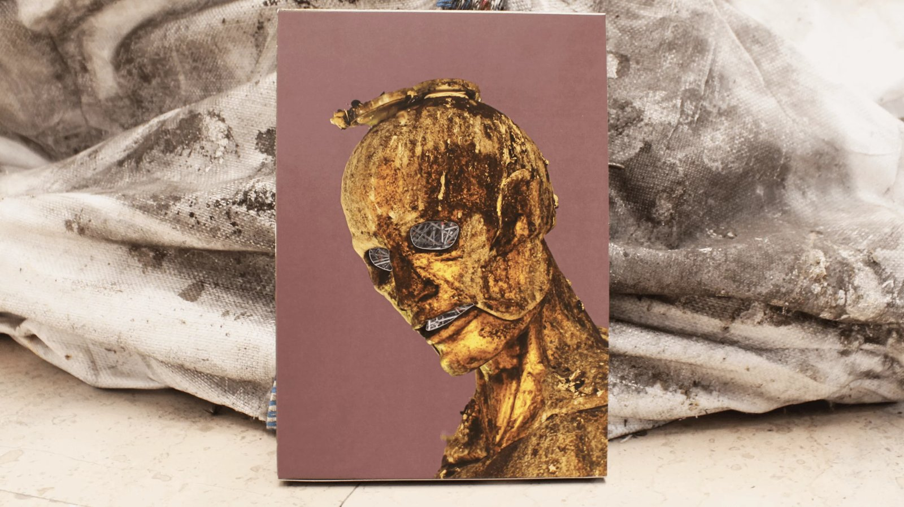

**HUMPTY \ DUMPTY**, a project by Cyprien Gaillard in autumn 2022, is an exhibition in two chapters, shown at the same time at the Palais de Tokyo and Lafayette Anticipations. 
The artist built it around a reflection on time: its traces, its effects, and the relationships humans form with it. The project takes its cue from the moment, as Paris frantically restores its most prestigious monuments and erases their signs of wear ahead of the Olympic Games.
Cyprien Gaillard shows how the city is a prime ground for entropy (decay, disorder and the unpredictable) to express itself, and how humans, in turn, tend to fight against that state. In the margins, the nooks and the spaces of dissent, the artist probes our desire for order, permanence and constancy, and finds there the stories of possible new equilibriums.

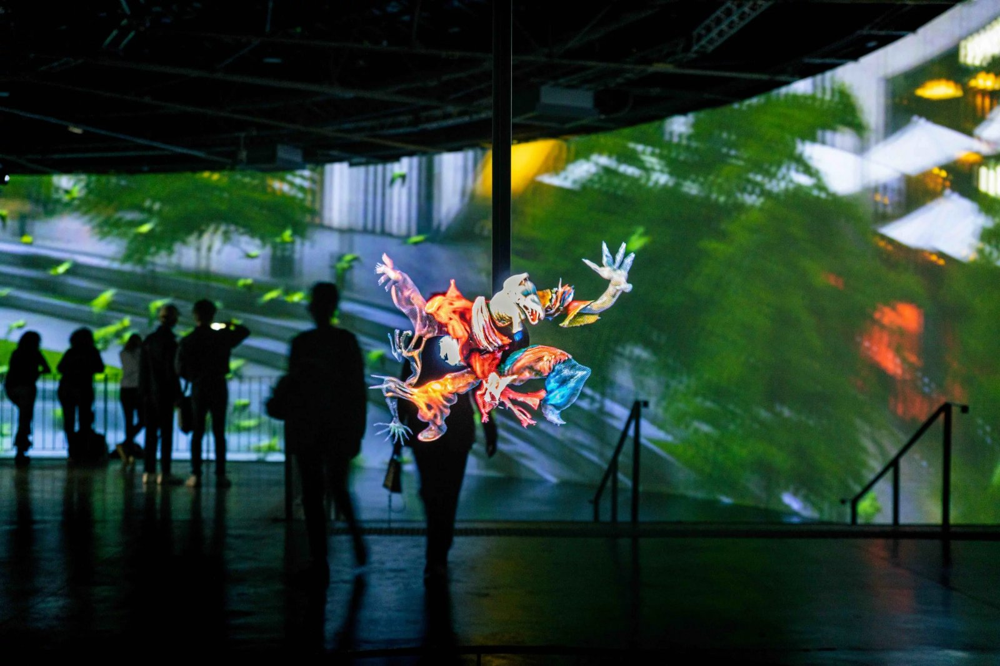

**HUMPTY \ DUMPTY** takes its title from Lewis Carroll's novel *Through the Looking-Glass*. It refers to the egg-shaped character who falls from a wall and who, despite many attempts, can never be restored to his original state.

## 2026-11-11
#thesis

What is mainstream/niche ? What is inclusive/exclusive ?

What is the link between body and fascism ?

What does it mean to be dignified? Do we really have any power over what becomes of our lives?

Is one kind of pain more legitimate than another?

What does society teach us about pain?

## 2026-10-20
#thesis #LiseMendes #VJing

Can be described as an art form that is both urban and spatial, halfway between scenography and contemporary art

Came about in the 1960s with psychedelic rock
Liquid Light Show

Turning spectators into participants

VHS video recorder, preview monitor, loops, computer-generated

Blurring the boundary between visual and musical arts

In 1984, one of the first video synthesizers

Today, DJs are closely linked to projection mapping

Concerts now have a double timeframe: the live event, and its circulation online

Book by Laura Glitsos, The camera phone in the concert space: Live music and moving images on the screen

Revolutionary staging at Shea Stadium, 1965
Projection on a giant screen

And now, audience members filming live on their phones

Hypertextual storytelling: each audience member adds their own footage to a collective, fragmented narrative

The concert becomes a space where a digital memory is produced collectively

## 2026-11-11
#thesis #PattiSmith #music

Music is spiritual

Patti Smith, Evidence, exhibition

Summary from the Centre Pompidou's website
A **poetic and immersive quest**, *Evidence* is an ode to a world without borders: a contemporary reflection on the infinite and the universal, and a spiritual search for **unity as a living, life-giving presence**. The physical, sonic and visual journeys of the Soundwalk Collective enter into an endless dialogue with the poetic paths of the American musician and poet Patti Smith, creating a new vision and a new language as this exploration unfolds. The *Evidence* exhibition seeks out metaphysical truths and the invisible, **unspeakable connections between times, beings and places**. It is more than an **archaeology** of travel: it is a journey in itself.

Soundwalk Collective is an experimental collective founded by Stephan Crasneanscki in New York in 2000 and joined by Simone Merli in 2008. Their artistic practice combines anthropology, ethnography, non-linear storytelling, psychogeography, observation of nature and experiments with sound recording. Each of their works starts from a specific place, natural or man-made, and requires long periods of research trips and fieldwork.

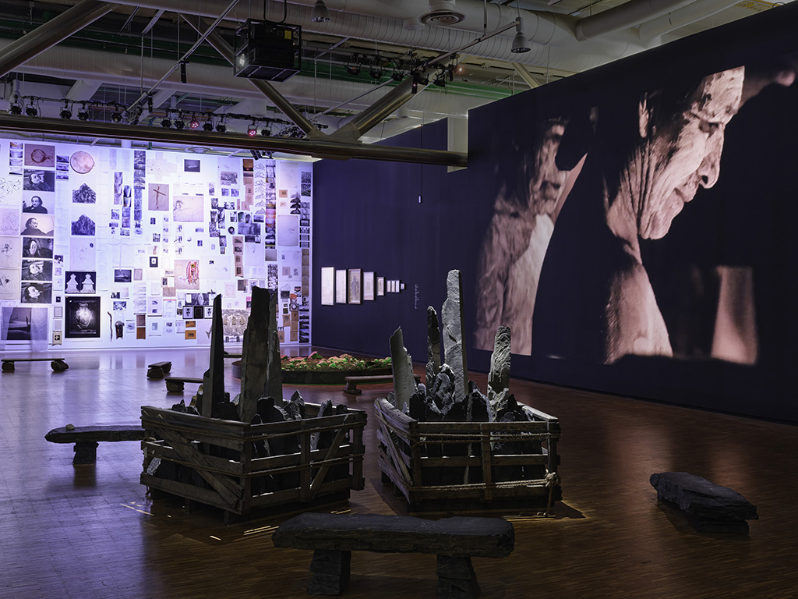

## 2026-10-14
#WendyChun #conference #thesis

Conflict can be a good sign
Groups are so polarized they're no longer talking to each other

## 2026-11-10
#GwenolaWagon #video #book #travel

Travel through the [Globodrome](https://d-w.fr/en/projects/globodrome/)
Gwenola Wagon, video and book
