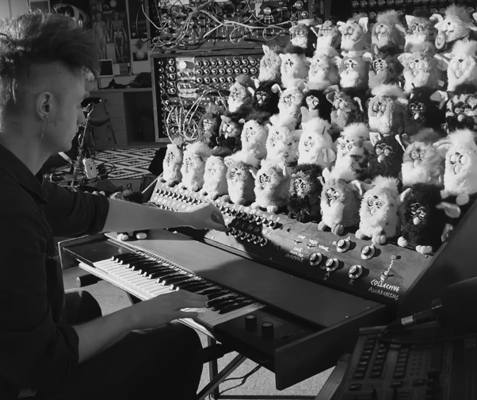
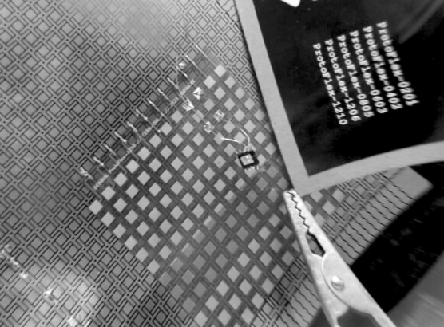

<!--
  MES NOTES — mode d'emploi

  Pour ajouter une note, copiez ce modèle EN HAUT de la liste (sous ce cadre) :

  ## 2026-10-10
  #cours #idées
  Le texte de la note. Il peut faire
  plusieurs lignes.

  - 1re ligne : « ## » puis la date au format année-mois-jour.
  - 2e ligne (facultative) : les sujets, chacun commence par #.
  - Ensuite : le texte.
  Ce cadre gris n'apparaît pas sur le site.
-->

## 2026-10-10
#artist #installation
I discovered an installation by Vytas Jankauskas *Life Forever Spa*.

I really like the tone between performance, immersive experience and all of the references implied to the purgatory, the relation to time.

I also discovered the museum that has comissionned this work.
The Foundation for Art and Creative Technology (FACT) is the UK's leading centre for contemporary art, cinema and digital culture, located in Liverpool.

[Life forever Spa](https://vjnks.com/projects/life-forever)

## 2026-10-09
#thesis #alumni #VJing
Lise Mendes's Thesis "VJing through social media".

I feel the structure is really clear and so it's easy to navigate.

## 2026-10-13
#artist #theory
Notes on Wendy Chun based on this article : [*Data Segregation and Algorithmic Amplification: A Conversation with Wendy Hui Kyong Chun*](https://www.researchgate.net/publication/335875650_Data_Segregation_and_Algorithmic_Amplification_A_Conversation_with_Wendy_Hui_Kyong_Chun) and this video : [*How are machine learning algorithms driving polarisation? by The British Academy*](https://youtu.be/AK_zNivJLMk?si=kdkFQ_X2Y7SjhfMy).

## 2026-10-14

#artist #theory #Joel-Vacheron
Joel Vacheron, conference, *Unseeing Space Imagery*

Their work published in a book *Cosmovision*

Inspired by [*Whole World Catalogue*](https://wholeearth.info/p/whole-earth-catalog-fall-1968?format=grid&index=0), Stewart Brand, 1968

The imagery of the universe, and planets have influenced human consciousness. We can't unsee these visions of the universe that engendered techno utopian litterature and culture.

Sci-fi imagery is really idealistic fiction but the litterature is based on tangible science. Exemples : Colonies in Space, Space Colonies, The High Frontier.

Colonialism, extractivism, it seems natural to humans to continue to colonize other lands.
Space anthropologist

Anibal Quijano "The repetition of the expansionsist idea comes from a special culture in which this is normalized". Companies want to make us feel that something very specific is universal.

They tried to collect easy to find imagery and not with a historian perspective.
The term of Cosmovision comes from Smirnoff.

We can learn to look to see have changed the world. We have to unsee how these changes are seen as beauty.

Imagery is never neutral

## 2026-10-14

#thesis #advice
What are the parameters I want to choose to conduct my research.

## 2026-10-07
#thesis #alumni #Electronic-Reapropriation

Faustine Perillaud, Mapping electronic reapropiation 2023-2024

Table of contents

Introduction
- I Subcultures & empirical learning in community
- II Electronic reuse in the field of art
- III Re-appropriation in the manufacturing environment
- IV Re-evaluating design practices

Conclusion
Annexes

To me the plan is : Context definition, Artistic examples,  Industrial examples, Open questions

- practices surrounding the reappropriation of electronics in the Western World

- CCC (Chaos Computer Club), a hacker group active in German-speaking countries since 1981
- The category of "maker" greatly spread the concept of DIY tech culture, but in the process of popularization, it lost the core "punk tech attributes of DIY art."

Materials & method
- fab lab access digital fabrication tools and technologies
- techno-feminist and queerfriendly identity
- feminist hackerspaces were founded as counterproject
- second-hand

" A trans and techno-feminist space for meeting, playing, experimenting and hacking [...]. FluidSpace is a moving, physical space, waiting to be brought to life, where women and gender dissidents can meet from time to time, discuss our relationship with technology, play, open objects, repair them, build new ones, hack systems, invent stories..."

- electronic components ideal low cost
- trying new things without the fear to mess up
- affordable empirical learning matter
- Circuit bending is an experimental approach to electronic music and sound art
- By pressing your finger on the right spots, you can tweak the parameters of the circuit and by the same time, distort the sound of the keyboard
- Their new status after re-use thus oscillates between prototype and intermediate object

Unbinare Lab "Dead bug"
- Producing a tool giving access to this type of component therefore opens the way to a new field of experimentation.
- it enables users to work on a considerably reduced scale, and microelectronics components are often difficult to work with in independent electronics communities

- new experimental perspectives without concurrently requiring new equipment

This thesis is auto-biographic with their relationship to the subject, how they encountered this, some context, and it's also an inventory of what has been done in the field of electronic reapropriation.
I would say mostly chronological.

## 2026-10-14
#artist
Trevor Paglen, The Last Picture

[Creating a mirror to engineer Earth](https://www.reflectorbital.com)

## 2026-10-13
#artist #theory #Wendy-Chun

Discriminating Data: Individuals, Neighborhoods, Proxies

Professor Chun began her talk at the 2019 Congress by outlining the five-step pro-
gram that defines Discriminating Data:

1. Expose and investigate how ignoring differences amplifies discrimination, both currently and historically. (The dangers of hopeful ignorance.)
2. Interrogate the default assumptions and axioms that ground algorithms and data structures. (Eugenics and U.S. segregation as embedded within current network axioms.)
3. Apprehend the future machine-learning algorithms put in place, focusing on when, why, and how their predictions work.
4. Use existing artificial intelligence (AI) systems to diagnose current in-equalities; corralling discriminatory predictions as evidence of current and historical forms of discrimination.

## 2026-10-14
#theory #artist #James-Bridle

[Ways of Being, James Bridle, 2022](https://jamesbridle.com/books/ways-of-being)

[New Dark Age, James Bridle, 2018](https://jamesbridle.com/books/new-dark-age)

## 2026-10-14

Wendy Chun conference, Data Fluencies

Naomi Astra Klen Taylor, End Times Fascism, 2026

Dystopian sci-fi, bunkers, cyberpunk

AGI become the most conspirationnal

They were conviced that AI will destroy the world, they want to accomplish the prophecy
Long termism

Wether or not it will happen, we dont yet know what human intelligence is

Atlas of AI Kate Crawford
The AI Con

Intelligence and language are already artificial but what we really want to avoid is an autoritarian system

Digital democracies institute at Simon Fraser University

They needed to respond to crisis, why and how algorithm discriminates
segregation by algorithm structures

Election of both fake news and Authenticity (Trump)

A way to understand personalized feeds
A global picture of social media trends
Case studies of past events

The researchers don't want to replicate the surveillance

COVID-19 test tool, 

Conflict can be a good sign

Groups are so polarized they're no longer talking to each other

Data literracy - follow the rules
Data fluencies - create speak move things articulate

Even when something is true, does it matter ?

Humanities and AI
Cartographer's tool

Influence functions, the way climate change IA predictions works

Technical Defaults are cultural defaults

Homophily creates networks echo chambers (entre soi, bulle de filtres)
Homophily makes that we repell each other but also attract each other

We need to have gaps to make the networks connections

Data Visceralization

When data shapes our bodies and borders

Kelly Dobson 
Parapraxis of machine design and use

We communicate because we're separation 

Designing communication is designing separation

Blendie, performance, 2003

Companion projects

Questions